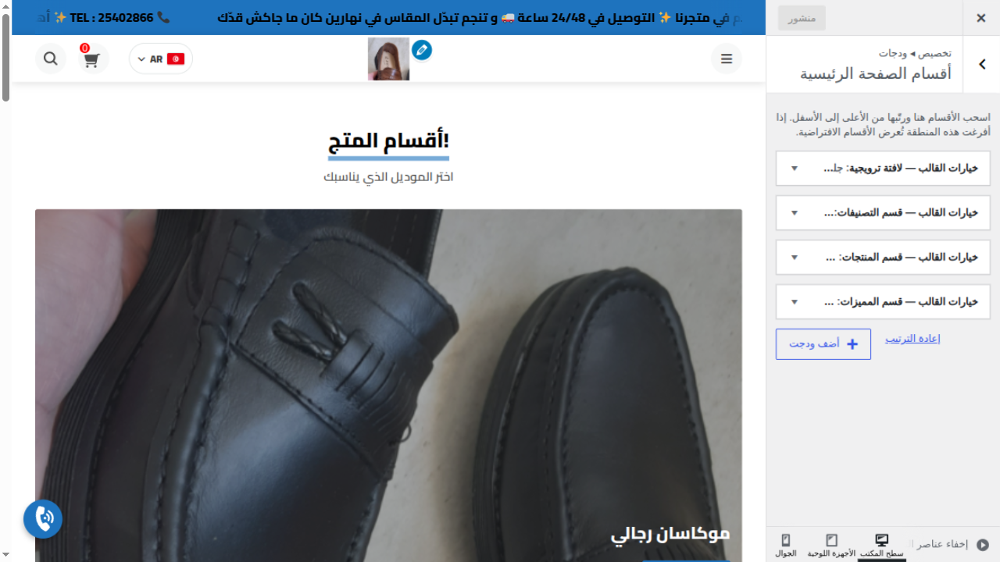
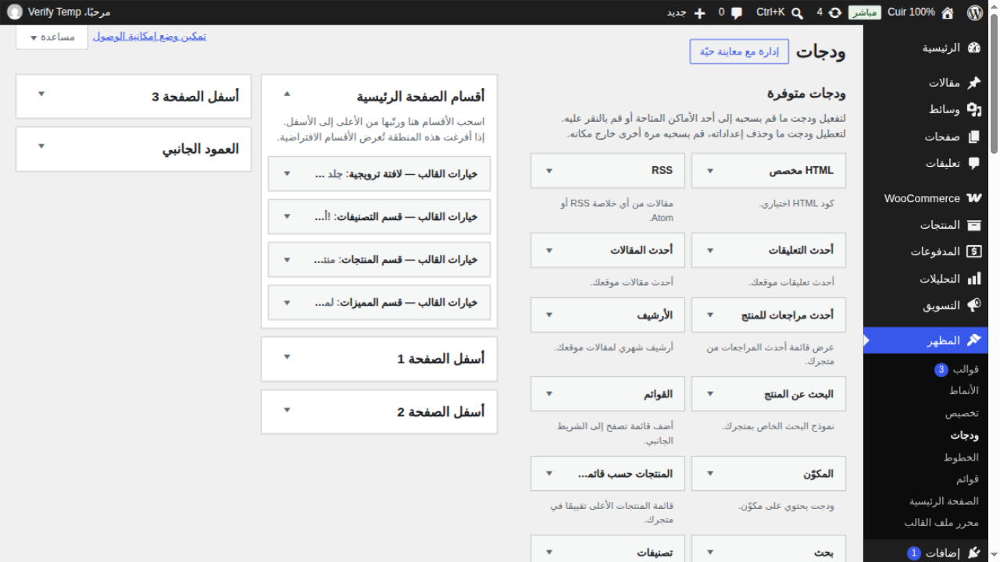
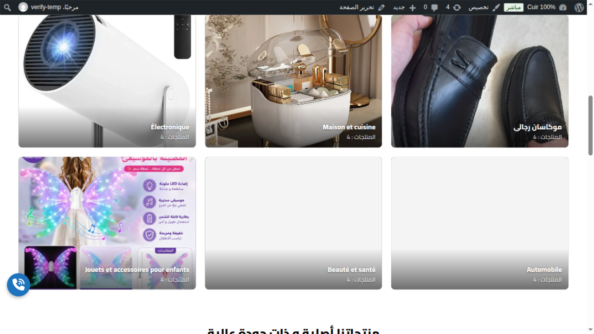
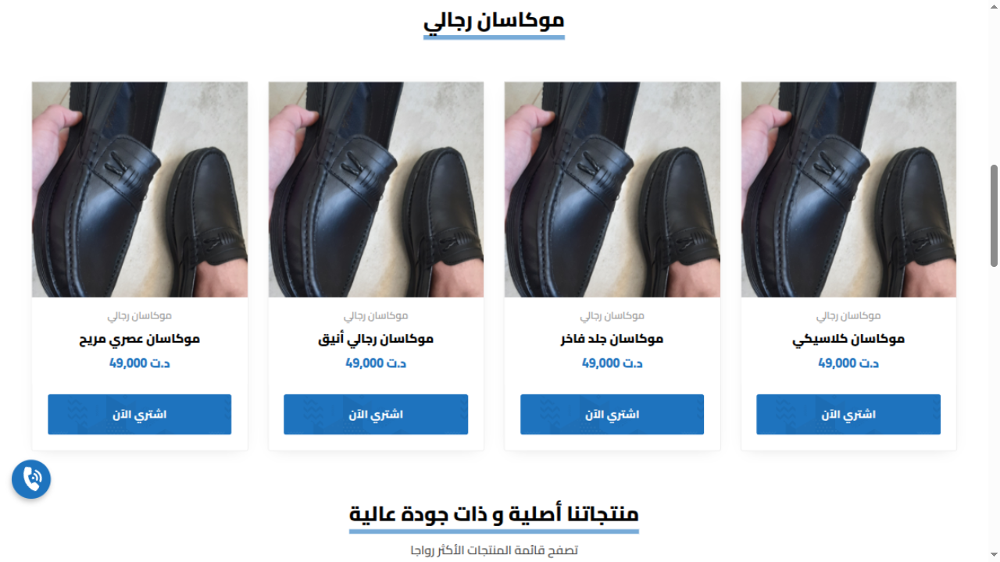
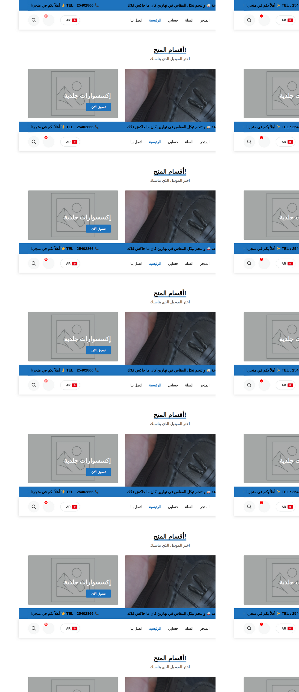

# Guide admin — Personnaliser la page d'accueil

Le thème **WPArabicEcommCOD** permet de composer la page d'accueil sans toucher au code :
sections réordonnables, masquables, dupliquables, avec textes traduits par langue.
Tout se fait depuis l'administration WordPress (interface en arabe).

> Système vérifié en conditions réelles le 2026-10-11 (test d'activation/désactivation
> d'une section via le Customizer, publication, contrôle sur le site public, restauration).

## 1. Accéder à la personnalisation

**Voie recommandée — avec aperçu live :**

**Apparence (المظهر) → الصفحة الرئيسية**

Ce raccourci ouvre le Customizer directement sur la zone des sections de la page
d'accueil, avec le site affiché en aperçu à côté. Chaque modification se voit en direct.

**Voie classique — écran complet :**

**Apparence (المظهر) → ودجات (Widgets)** puis zone **« أقسام الصفحة الرئيسية »**
(sections de la page d'accueil). L'écran est resté volontairement en mode « classique »
(glisser-déposer), pas en éditeur de blocs.

## 2. Les 4 types de sections

Dans l'admin, les sections du thème sont préfixées **« خيارات القالب »** (options du thème) :

| Widget | Rendu sur le site | Réglages principaux |
|---|---|---|
| **لافتة ترويجية** — bannière | Grande bannière promo en haut | image de fond, titre, sous-titre, texte + lien du bouton, hauteur (normale/haute) |
| **قسم التصنيفات** — catégories | Tuiles de catégories de produits | 5 maquettes : mosaïque, blocs égaux (بلاطات متساوية), grille de cartes, cercles, carrousel ; nombre de colonnes par rangée (2–6) pour les blocs égaux et la grille ; nombre de catégories ; choix des catégories |
| **أقسام حسب التصنيف** — produits par catégorie | Sections empilées : une par catégorie choisie, chacune avec une grille de **cartes produits choisies par l'admin** (photo, prix, promo) | nombre de groupes (1–6), catégorie par groupe, titre personnalisé facultatif (vide = nom de la catégorie), cases à cocher des produits, colonnes 2–6 ; en-tête global facultatif |

Exemple de la maquette blocs égaux (nom et compteur en surimpression sur l'image) :

Exemple du widget « أقسام حسب التصنيف » (cartes produits groupées par catégorie) :

| **قسم المنتجات** — produits | Grille de produits | nombre (1–24), colonnes (4/5), tri (date/popularité/aléatoire), filtre par catégorie |
| **قسم المميزات** — atouts | 4 blocs « icône + titre + texte » | 4 icônes FontAwesome + textes |

## 3. Les opérations

- **Réordonner** : glisser-déposer la section dans la liste. L'ordre affiché = l'ordre
  sur le site. *(Dans le Customizer, on peut aussi faire Maj + clic sur une section
  directement dans l'aperçu pour l'éditer.)*
- **Masquer sans perdre les réglages** : décocher **« إظهار هذا القسم في الصفحة الرئيسية »**
  (afficher cette section) dans le formulaire du widget.
- **Ajouter une section** : depuis la liste des widgets disponibles (ودجات متوفرة),
  glisser un des 4 widgets du thème dans la zone أقسام الصفحة الرئيسية.
- **Dupliquer** : ajouter une seconde instance du même type — par exemple deux grilles
  de produits (nouveautés + promotions).
- **Supprimer** : ouvrir le widget puis lien **« حذف »** (supprimer).
- **Publier** : bouton **« نشر »** en haut du Customizer (dans l'écran Widgets,
  l'enregistrement est automatique).
- **عرض ككاروسيل — carrousel** : case à cocher dans les widgets أقسام حسب التصنيف et قسم المنتجات. Une seule rangée navigable avec **flèches précédent/suivant** (défilement de 85 % de la largeur, flèches visibles à toutes les largeurs) ; le nombre de colonnes choisit combien de cartes sont visibles d'un coup.
- **تحريك تلقائي — défilement automatique** : sous l'option carrousel, case d'activation + durée entre deux pas (2 à 20 secondes, 4 par défaut). Avance en boucle (retour au début en fin de rangée), pause au survol et au toucher, respecte la préférence système « réduire les animations ».
- **عرض كامل — pleine largeur** : case à cocher dans les widgets أقسام حسب التصنيف, قسم المنتجات et قسم التصنيفات (maquettes blocs égaux, grille, carrousel). La grille s'étend d'un bord à l'autre de l'écran, les blocs se répartissant selon le nombre de colonnes choisi ; le titre reste centré au-dessus.
- **نسبة الصور — ratio des images** (1:1 par défaut, 4:3, 9:16, 7:10, 16:6) : disponible dans le widget أقسام حسب التصنيف, le widget قسم المنتجات, et le widget catégories (maquettes blocs égaux, grille, carrousel). Non applicable : mosaïque (composition fixe), cercles, bannière (réglage hauteur dédié).
- **Traduire les textes** : chaque widget contient un bloc **« الترجمات »** pour saisir
  les variantes par langue (les visiteurs voient la version de leur langue).

## 4. Contenu libre au-dessus des sections

La page définie comme accueil (**Pages → الرئيسية**) affiche son contenu **au-dessus**
des sections, dans la même grille — pratique pour un bloc d'annonce rédigé dans
l'éditeur. Laisser la page vide pour ne rien afficher.

## 5. Filet de sécurité

Si la zone est entièrement vidée, le thème affiche automatiquement les trois sections
d'origine (produits, atouts, catégories) : **la page d'accueil n'est jamais vide**.

---

## Annexe — état du site au 2026-10-11

Configuration actuelle de la zone (ordre et visibilité) :

| # | Section | État |
|---|---|---|
| 1 | Bannière (لافتة ترويجية) | **masquée** (case décochée) |
| 2 | Catégories (قسم التصنيفات) | visible |
| 3 | Produits (قسم المنتجات) | visible — 8 produits, 5 colonnes |
| 4 | Atouts (قسم المميزات) | visible |

Deux détails repérés pendant la vérification, à corriger si souhaité :

1. Le titre de la section catégories commence par un **« ! » parasite** :
   « !أقسام المتجر » — visible tel quel sur le site. Le retirer : Customizer →
   section التصنيفات → champ العنوان.
2. Le bouton de la bannière pointe vers `http://localhost:8082/shop/` (URL locale) —
   à remplacer par l'URL publique de la boutique si la bannière est réactivée.
